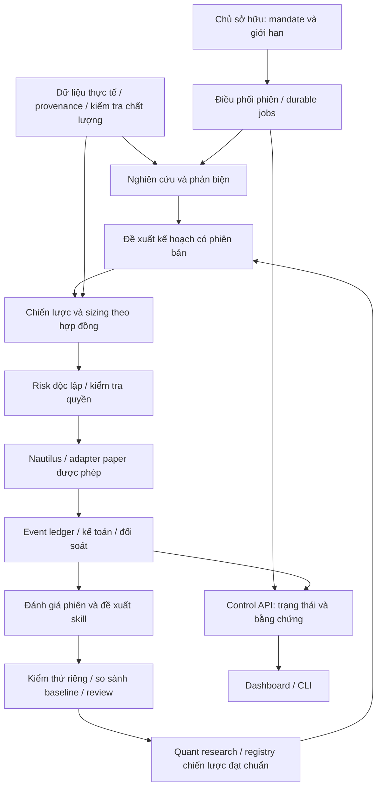

# Trading-Agent — North Star V4.0

**AI-Assisted Multi-Asset Quant Trading Platform**  
**Sản phẩm đầu tiên: một đội ngũ nghiên cứu và giao dịch crypto spot paper tự vận hành 24/7.**

| Thuộc tính | Giá trị |
| --- | --- |
| Phiên bản | 4.0 — North Star gốc, chính thức cho định hướng sản phẩm |
| Lựa chọn thị trường | Chủ dự án đã chọn crypto trước; đề xuất khởi đầu với BTC spot, chưa chốt venue/feed/runtime |
| Ngày soạn | 2026-10-14 |
| Ngày thông qua | 2026-10-15 |
| Đối chiếu nghiên cứu | 2026-10-15 — [khảo sát nguồn](research/2026-10-15-north-star-v4-oss-research.md) và [đánh giá thực nghiệm/người dùng mở rộng](research/2026-10-15-north-star-v4-real-world-review.md); làm rõ thiết kế, không đổi gate P3 |
| Quyết định của chủ dự án | “Vậy chuyển North Star V4 này làm North Star gốc cho dự án” |
| Phạm vi | Tầm nhìn, kiến trúc mục tiêu, lộ trình sản phẩm và tiêu chí nghiệm thu |
| Cơ sở nguồn được đối chiếu | Canonical checkout `8ee1c18a5b99bca78738b6d5ca572bd0afb7c0b3`, có thay đổi cục bộ |
| Hiệu lực | Nguồn định hướng sản phẩm chính thức; thay V3.1 ở vai trò roadmap gốc. Hợp đồng qualification, safety và quyền runtime hiện hành được giữ theo mục 15 |

Đường dẫn chuẩn duy nhất của North Star hiện hành là `docs/NORTH-STAR-V4.md`.
README, AGENTS và hướng dẫn công cụ trỏ về tài liệu này; không tạo bản sao nội dung
làm nguồn quyết định thứ hai. Các lựa chọn được ghi là “đề xuất” vẫn cần chốt trong
mandate cụ thể; việc thông qua roadmap không tự chọn venue, provider hay ngân sách.

## 1. Tuyên bố North Star

> Xây dựng một nền tảng định lượng hoạt động liên tục, tổ chức AI và phần mềm chuyên dụng thành một tập thể có trách nhiệm rõ ràng: nghiên cứu từ thông tin thực tế, hình thành và phản biện giả thuyết, kiểm chứng chiến lược, vận hành paper theo dữ liệu thị trường, đối soát kết quả và đề xuất cải tiến có thể đo lường — trong giới hạn rủi ro do con người quyết định.

Giá trị cần tạo ra là biến một ý tưởng giao dịch thành một quyết định có bằng chứng, một lần thực thi có kiểm soát và một kết quả có thể giải thích. Hệ thống phải giúp chủ dự án điều hành cả quy trình mà không phải theo dõi thủ công từng bot.

“24/7” là khả năng giám sát, lưu trạng thái, phục hồi và chuẩn bị công việc liên tục. Nghiên cứu chạy theo lịch hoặc sự kiện; giao dịch theo tín hiệu, sức khỏe venue và mandate, không phụ thuộc giờ mở cửa chứng khoán. LLM không cần gọi liên tục. Một chu kỳ không có giao dịch vẫn có thể là kết quả đúng.

Trong bản crypto này, “phiên” là cửa sổ vận hành/đánh giá do hệ thống định nghĩa theo UTC, không phải phiên đóng/mở của sàn. Ranh giới chu kỳ không tự hủy lệnh, đóng vị thế hoặc reset risk; trạng thái phải được bàn giao liên tục.

## 2. Định vị và người sử dụng

Kiến trúc kết hợp **Quant Trading Platform + Algorithmic Trading System làm lõi, AI Trading Agent làm lớp nghiên cứu và điều phối**. Các trading bot là những đơn vị thực thi chiến lược trong hệ thống này. Bốn khái niệm không phải bốn cấp độ bắt buộc phải xây lần lượt.

| Thành phần | Vai trò trong Trading-Agent | Thẩm quyền |
| --- | --- | --- |
| Quant Platform | Dữ liệu, nghiên cứu, backtest, quản lý phiên bản chiến lược, danh mục, đánh giá và quan sát | Lưu bằng chứng và kết quả có thể kiểm tra |
| Algorithmic System | Tín hiệu, sizing, kiểm soát rủi ro, quản lý lệnh, thực thi và đối soát | Chỉ hành động theo hợp đồng, chính sách và quyền được cấp |
| AI Agents | Tìm thông tin, nghiên cứu, phản biện, tổng hợp, chọn công cụ nghiên cứu, đề xuất kế hoạch và cải tiến | Không tự ghi trạng thái chuẩn hoặc vượt kiểm soát rủi ro |
| Trading Bots | Chạy từng chiến lược đã được cho phép | Mọi đề xuất lệnh đi qua kiểm soát chung |

Người dùng đầu tiên là chủ dự án, sau đó là nhà nghiên cứu độc lập và nhóm định lượng nhỏ. Công việc họ cần hoàn thành: chuẩn bị phiên, kiểm tra luận điểm, vận hành paper, giải thích kết quả và lựa chọn nghiên cứu tiếp theo.

Đa tài sản là hướng mở rộng kiến trúc. **Crypto là thị trường đầu tiên theo lựa chọn mới nhất của chủ dự án.** Phạm vi đề xuất là BTC spot trước, một cặp và một venue; không triển khai đồng thời nhiều altcoin, perpetuals, futures, options hoặc cổ phiếu. ETH spot và các tài sản khác chỉ được xem xét sau khi phạm vi đầu hoạt động ổn định và có bằng chứng riêng.

## 3. Lựa chọn kiến trúc

| Phương án | Lợi ích | Giới hạn | Quyết định |
| --- | --- | --- | --- |
| Bot đơn lẻ với dashboard | Phạm vi nhỏ, dễ chứng minh một chiến lược | Không bao phủ đầy đủ tập thể nghiên cứu, đánh giá và quản lý danh mục | Dùng như một đơn vị trong nền tảng |
| Đội LLM làm trung tâm mọi quyết định | Linh hoạt trong nghiên cứu và diễn giải | Khó kiểm soát tính nhất quán, chi phí và quyền giao dịch nếu giao toàn quyền | Không chọn làm chủ thể của risk, accounting hoặc execution |
| Lõi định lượng và thực thi độc lập, AI hoạt động qua hợp đồng | Tái sử dụng Nautilus và nguồn hiện có; kiểm tra được từng tầng | Cần nối luồng dữ liệu và bàn giao rõ ràng | Kiến trúc định hướng được chọn cho V4 |

Tách các vai trò theo công việc; chỉ tách thành nhiều agent hoặc process khi có lợi ích đo được. Giữ phương án workflow cố định cho công việc có quy tắc rõ. AI chủ động chọn công cụ ở những nhiệm vụ nghiên cứu cần linh hoạt. Nguyên tắc này phù hợp với phân biệt workflow/agent và khuyến nghị tăng độ phức tạp theo nhu cầu của [Anthropic](https://www.anthropic.com/engineering/building-effective-agents).

## 4. Thành công được đo bằng gì?

**Chỉ số North Star: tỷ lệ phiên paper hoàn tất đúng quy trình, đối soát được và không cần can thiệp ngoài kế hoạch, trên toàn bộ phiên đủ điều kiện đã lên lịch.**

- Phiên đủ điều kiện được xác định trước giờ chạy từ lịch chu kỳ UTC và mandate, bao gồm cuối tuần khi nằm trong phạm vi 24/7. Không bỏ phiên lỗi khỏi mẫu số sau khi biết kết quả.
- Tử số chỉ gồm phiên có dữ liệu đạt yêu cầu, đầu ra nghiên cứu/kế hoạch đúng hạn, kiểm soát rủi ro hoạt động, đối soát hoàn tất và báo cáo truy nguyên được.
- Phiên không giao dịch do không có tín hiệu hợp lệ có thể đạt; phải có bằng chứng đánh giá. Phiên ngừng an toàn vì mất dữ liệu được ghi là sự cố được kiểm soát, không phải phiên hoàn tất bình thường.
- Cửa sổ bảo trì đã lên kế hoạch được khai báo trước khi quan sát kết quả. Sự cố venue hoặc dữ liệu phát sinh trong chu kỳ vẫn được ghi nhận, không loại khỏi mẫu số để tăng tỷ lệ đạt; độ sẵn sàng 24/7 được đo riêng.

| Nhóm chỉ số | Cách đo bắt buộc |
| --- | --- |
| Độ tin cậy | Phiên hoàn tất/phiên đã lên lịch; job trùng; sai lệch sổ; thời gian phát hiện và phục hồi sự cố |
| Chất lượng dữ liệu | Độ trễ từ nguồn tới hệ thống, tỷ lệ thiếu, nguồn gốc và thời điểm thông tin có thể được biết |
| Chất lượng nghiên cứu | Nhận định có bằng chứng hỗ trợ, sai nguồn, dữ liệu quá hạn, xử lý mâu thuẫn và tỷ lệ từ chối kết luận khi thiếu dữ liệu |
| Hiệu quả chiến lược | Kết quả ngoài mẫu, drawdown, turnover, exposure, chi phí và độ nhạy với giả định khớp lệnh |
| Giá trị của AI | So sánh với cùng lõi chiến lược không dùng AI, trên phạm vi và dữ liệu đánh giá tương đương |
| Công sức con người | Phút thao tác thực tế và số lần can thiệp quan sát được; không suy ra từ số tool call hoặc thời gian máy chạy |
| Kinh tế vận hành | Chi phí dữ liệu, LLM, hạ tầng và chi phí trên mỗi phiên; phần không đo được phải ghi unknown |

Mỗi chiến dịch phải đóng băng ngưỡng, thời gian quan sát, cỡ mẫu, benchmark và cách tính trước khi xem kết quả. Không dùng lợi nhuận của một phiên, số lượng agent, số test hoặc số skill làm bằng chứng thành công của toàn sản phẩm.

Chỉ số North Star trên đo **khả năng vận hành**, không thay thế economic acceptance. Báo cáo ba kết luận độc lập: vận hành đáng tin cậy; chiến lược có giá trị sau chi phí; AI tạo thêm lợi ích. Với chiến dịch mới, so với giữ quote, BTC buy-and-hold và baseline xác định trước trên cùng phạm vi; ghi cả return, drawdown, exposure, turnover và độ bất định. Tách phí giao dịch khỏi chi phí data/LLM/hạ tầng, tránh tính hai lần. Tiêu chí giảm rủi ro hoặc tăng lợi nhuận phải chốt trước, không chọn lại theo kết quả.

## 5. Điểm xuất phát và cách tái sử dụng

Đây là nhận xét từ nguồn và tài liệu đã đối chiếu, không phải xác nhận runtime hoặc toàn bộ candidate đang triển khai.

| Nền tảng hiện có | Căn cứ | Cách dùng trong V4 |
| --- | --- | --- |
| Nautilus, ledger, kế toán độc lập và paper recovery | [Module ownership](implementation/p1-real-nautilus/module-ownership.md) | Giữ owner hiện có, nối workflow mới qua hợp đồng; không viết lại engine |
| Risk theo quy tắc | [Runtime risk evaluator](../packages/runtime_risk/evaluator.py) | Kiểm chứng mandate BTC spot, quote currency, giới hạn và venue cụ thể; không mặc định mọi sản phẩm đều đã được hỗ trợ |
| Job scheduling | [Scheduler](../services/job_scheduler/scheduler.py), [slot policy](../services/job_scheduler/slots.py) | Tái sử dụng durable jobs và idempotency; bổ sung chu kỳ nghiên cứu/đối soát UTC và trigger sự kiện có giới hạn |
| Market-data contract | [Fixture](../services/market_data/fixture.py), [ingestion](../services/market_data/ingestion.py) | Giữ kiểm thử fixture BTC; nối và kiểm chứng feed crypto thực riêng, không coi fixture là adapter thực |
| Chuyên viên AI | [Analysts](../legacy/research-backend/analysts.py) | Tái sử dụng nghiệp vụ crypto; kiểm chứng dữ liệu giá, tin tức, vĩ mô và nguồn on-chain nếu được dùng; không lấy stub làm bằng chứng |
| Reflection | [Reflection engine](../legacy/research-backend/reflection_engine.py) | Dùng làm đầu vào đề xuất cải tiến; không xem reflection là bằng chứng skill tốt hơn |
| API và dashboard | [HWC boundaries](adr/ADR-HWC-HEADLESS-OPERATOR-BOUNDARIES.md) | Giữ core độc lập giao diện; dashboard trình bày trạng thái và bằng chứng |

Việc tồn tại source hoặc test không chứng minh đường chạy đã nối end-to-end, dữ liệu đang mới, chiến lược đạt economic gate hay runtime được cấp quyền. Bản V4 không công bố phần trăm hoàn thành dựa trên số module.

## 6. Tập thể vận hành mục tiêu

| Vai trò | Đầu ra chịu trách nhiệm | Ranh giới |
| --- | --- | --- |
| Chủ sở hữu | Mandate, ngân sách, giới hạn rủi ro, quyết định đưa phiên bản vào sử dụng | Giữ thẩm quyền mở rộng phạm vi và kích hoạt live riêng |
| Điều phối phiên | Kế hoạch công việc, thời hạn, dependency, trạng thái và escalation | Dùng durable jobs; không tự tạo quyền hoặc sửa risk limits |
| Dữ liệu và kiểm chứng | Bộ bằng chứng đúng instrument, có timestamp, độ mới và chất lượng | Nguồn bên ngoài và nội dung tải về là dữ liệu không đáng tin cho tới khi kiểm tra |
| Nghiên cứu thị trường crypto | Bối cảnh BTC, cấu trúc giá/thanh khoản, vĩ mô, tin tức, sự kiện giao thức và on-chain khi có dữ liệu đạt chuẩn | Phân biệt dữ kiện, suy luận, giả định và điều chưa biết; on-chain nâng cao không là blocker của bản đầu |
| Phản biện | Bằng chứng ngược, giả định yếu, điều kiện bác bỏ luận điểm | Không dùng biểu quyết giữa các LLM làm chứng minh sự thật |
| Quant và danh mục | Chiến lược đã kiểm chứng, đề xuất phân bổ và kế hoạch phiên | Chỉ dùng registry được phép; không đưa code mới vào đường giao dịch ngay trong phiên |
| Risk | Chấp nhận/từ chối theo giới hạn danh mục, lệnh, dữ liệu và sức khỏe hệ thống | Quyết định bằng quy tắc độc lập, có quyền phủ quyết |
| Execution và vận hành | Trạng thái lệnh/fill, reconnect, checkpoint, xử lý sự cố | Thực thi qua engine và adapter đã kiểm chứng |
| Kế toán và đánh giá | Sổ tiền/vị thế, đối soát, kết quả, nguyên nhân và đề xuất cải tiến | Không để agent nghiên cứu ghi lại lịch sử hoặc tự chấm mình đạt |

Một vai trò có thể gồm code, công cụ và AI. Mốc đầu dùng nghiên cứu/tổng hợp và phản biện ở phạm vi nhỏ; không đặt số lượng bot cố định làm tiêu chí nghiệm thu.

## 7. Kiến trúc và đường đi của quyết định

Sơ đồ là kiến trúc mục tiêu; các mũi tên không tuyên bố đã được triển khai. Kế hoạch nghiên cứu chỉ trở thành đầu vào thực thi khi qua kiểm tra schema, thời hạn, strategy registry, mandate và risk. AI không kết nối trực tiếp tới broker để gửi lệnh.

Giữ ba đồ thị dependency hiện tại: root Python, research backend và dashboard. Không import backend vào core cùng process. **Control API chỉ đọc; Job API sở hữu durable jobs; Operator API chỉ sở hữu các lệnh đã được định nghĩa.** Bất kỳ quyền promote, pause/resume hoặc đổi chiến lược mới nào cũng cần thiết kế hợp đồng riêng; sơ đồ này không bổ sung ngầm endpoint hay quyền.

Nautilus cung cấp nền tảng engine; adapter, venue, dữ liệu và runtime cụ thể của ứng dụng vẫn phải được kiểm chứng. [Tài liệu upstream](https://nautilustrader.io/docs/latest/concepts/overview/) là tham khảo kiến trúc, không thay thế bằng chứng cho phiên bản đã pin trong dự án.

## 8. Hợp đồng dữ liệu và bàn giao

Các tên dưới đây là khái niệm thiết kế, chưa phải yêu cầu tạo thêm package hoặc sửa generated contracts.

| Hồ sơ | Nội dung tối thiểu |
| --- | --- |
| Mandate | Thị trường, instrument universe, chiến lược, timeframe, vốn paper, giới hạn, quyền, ngân sách và điều kiện dừng |
| Evidence bundle | Instrument identity, nguồn, event/published/received time, as-of, revision, hash nội dung, chất lượng và quyền sử dụng dữ liệu |
| Research thesis | Nhận định, bằng chứng hỗ trợ/ngược lại, giả định, hạn sử dụng, điều kiện mất hiệu lực; confidence không tự coi là xác suất đã hiệu chuẩn |
| Session plan | Session ID, phiên bản, universe, strategy/version được phép, điều kiện vào/thoát, sizing policy, references tới evidence và mandate |
| Risk decision | Đầu vào và policy version, accept/reject, lý do, giới hạn còn lại, thời điểm và liên kết tới đề xuất |
| Execution/accounting record | Intent, order/fill IDs, event times, phí, vị thế, tiền, idempotency và kết quả đối soát |
| Evaluation/skill proposal | So sánh baseline, mẫu đánh giá, giả thuyết cải thiện, chi phí, lỗi, phiên bản và phương án hoàn nguyên |

Tái sử dụng schema tương đương đã có trước khi thêm schema mới. Mọi bàn giao gắn được với session/job ID, source/model/prompt/tool/skill version và đầu vào chính xác. Replay dữ liệu đã lưu phải phân biệt với gọi lại mô hình có thể cho kết quả khác.

Thông tin thị trường/giao thức phải đúng thời điểm được biết; phân biệt symbol, base/quote, venue và chain khi áp dụng. Khi mở rộng token, xử lý migration, đổi mã, delisting và survivorship bias. Dữ liệu on-chain cần thời điểm quan sát, chính sách xác nhận/reorg và nguồn kiểm chứng nếu được dùng. Không dùng dữ liệu tương lai hoặc thông tin token hiện tại để giả làm dữ liệu lịch sử.

## 9. Một ngày vận hành

| Giai đoạn | Công việc | Điều kiện chuyển bước |
| --- | --- | --- |
| Giám sát liên tục | Kiểm tra sức khỏe venue/feed, cập nhật dữ liệu, đối soát trạng thái | Không mở thêm rủi ro khi lệnh/tiền/vị thế hoặc dữ liệu chưa rõ |
| Trước chu kỳ quyết định | Thu thập bằng chứng, nghiên cứu và phản biện theo lịch UTC hoặc sự kiện | Dữ liệu đủ mới, nghiên cứu đúng hạn và trong ngân sách; gom sự kiện và giới hạn số lần gọi |
| Chốt kế hoạch | Gắn strategy, mandate, điều kiện hủy và phiên bản kế hoạch | Kiểm tra quyền, risk và dependency đều đạt |
| Trong chu kỳ | Nhận dữ liệu, chạy chiến lược, kiểm tra risk, thực thi paper, giám sát sự kiện | Mỗi hành động vẫn nằm trong phạm vi và dữ liệu còn hợp lệ |
| Checkpoint/đối soát định kỳ | Đối soát, báo cáo và bàn giao lệnh/vị thế sang chu kỳ sau | Tiền, vị thế, fills và lệnh được giải thích đầy đủ; không tự đóng vị thế khi đổi ngày UTC |
| Đánh giá sau chu kỳ | Phân tích kết quả, attribution, đề xuất skill và nghiên cứu tiếp | Chỉ tạo ứng viên; không tự thay phiên bản đang được phép chạy |

Lịch chuẩn dùng UTC và bao phủ cả cuối tuần; hiển thị giờ địa phương không thay đổi ranh giới nến. Phải xử lý bảo trì, ngừng giao dịch instrument, mất feed và gián đoạn venue. Kế hoạch sửa giữa chu kỳ phải có phiên bản mới và kiểm tra lại, không ghi đè quyết định cũ. Chu kỳ nghiên cứu không tự thay timeframe của chiến lược: P3 D1 vẫn đánh giá theo nến ngày đã đóng trong hợp đồng hiện tại.

Tách nhịp nghiên cứu khỏi nhịp giám sát rủi ro. Nghiên cứu nhận snapshot risk/exposure hiện tại để tạo đề xuất khả thi; risk vẫn kiểm tra độc lập trước thực thi và giám sát theo feed/mandate trong thời gian giữ vị thế. Chu kỳ cụ thể phải được thiết kế và kiểm chứng, không mặc định gọi LLM mỗi tick hoặc sao chép nhịp 5 phút từ một bài báo. Đây là hướng cho thiết kế mới, không sửa cách thực thi của candidate P3 đã đóng băng.

Mất dữ liệu, thiếu nghiên cứu bắt buộc hoặc kế hoạch hết hạn phải chặn mở rủi ro mới. Quản lý vị thế đang có tuân theo chính sách sự cố đã duyệt; không mặc định đóng sạch hoặc bỏ mặc vị thế. LLM lỗi không được vô hiệu hóa risk, ledger hay các cơ chế bảo vệ xác định trước.

## 10. Phạm vi sản phẩm đầu tiên

**Crypto spot trước; đề xuất một cặp BTC, một venue, một chiến lược đủ điều kiện, một đường thực thi paper và một chủ vận hành.** Giữ nghiên cứu P3 BTC D1 theo phạm vi hiện tại; timeframe mới cần đánh giá riêng. Hệ thống nhận dữ liệu và giám sát liên tục nhưng không cần tạo lệnh mỗi tick hoặc mỗi chu kỳ nghiên cứu. Hệ thống phải chạy được mà không cần mở dashboard.

P3 dùng `BTCUSDT.BINANCE` làm instrument nghiên cứu; điều đó không chọn Binance làm venue vận hành, không xác nhận quyền truy cập và không cho phép nối tài khoản. Venue, cặp quote và feed paper phải được chọn/kiểm chứng riêng. Không coi BTC/USD và BTC/USDT là cùng một instrument hoặc USDT luôn bằng USD; mandate phải quy định định giá và điều kiện xử lý mất neo nếu dùng stablecoin.

Hai đường paper có thể xem xét là feed thực + mô phỏng khớp lệnh trong engine, hoặc paper account của nhà cung cấp. Chọn một đường đầu tiên theo khả năng adapter, độ trung thực dữ liệu, chi phí và quyền truy cập; không xây đồng thời cả hai chỉ để tăng phạm vi.

Danh sách quyết định sau phải được ghi vào mandate trước khi triển khai phần phụ thuộc:

| Quyết định | Người chịu trách nhiệm và điều kiện |
| --- | --- |
| Venue, cặp base/quote và chu kỳ UTC | Chủ dự án chọn; đề xuất BTC spot trước; kiểm chứng instrument, tick/lot/minimum notional và quyền truy cập |
| Feed, tin tức và dữ liệu crypto | Chọn theo timeframe, độ trễ, lịch sử và giấy phép; không mặc định dữ liệu giữa các venue thay thế cho nhau; on-chain chỉ thêm khi có use case |
| Paper nội bộ hay provider paper | Chủ dự án chọn sau kiểm tra tương thích engine/adapter; external access cần quyền riêng |
| Strategy, vốn, sizing và giữ vị thế qua chu kỳ | Đóng băng trước đánh giá; đề xuất chỉ mua/giữ quote, không margin, short hoặc phái sinh; giới hạn lỗ không tự reset theo lần restart |
| Ngưỡng chất lượng, risk và vận hành | Ghi giá trị cụ thể cho freshness, deadline, exposure, loss, recovery và mẫu quan sát; thiếu giá trị thì chưa sẵn sàng chạy |
| Ngân sách và người nhận sự cố | Có trần LLM/data/compute, retry/concurrency và thời hạn xử lý; hết ngân sách không chuyển thành quyền gọi thêm |

ML nâng cao, RL, graph memory, nhiều broker và nhiều tài sản chưa phải điều kiện của mốc đầu. Các module này chỉ được thêm khi có vấn đề và baseline cụ thể.

## 11. Lộ trình theo kết quả

Các mã NS dưới đây là milestone sản phẩm V4, **không đổi tên hay thay thế P0–P11**. Các công việc độc lập có thể chuẩn bị song song trong phạm vi được phép; không yêu cầu hoàn tất một nền tảng lớn trước khi thử một lát cắt nhỏ.

| Mốc | Kết quả cần đạt | Điều kiện nghiệm thu và dependency |
| --- | --- | --- |
| NS0 — Chốt mandate và tái sử dụng | Có bản đồ nguồn tái sử dụng, khoảng trống crypto spot 24/7, chủ sở hữu và phạm vi đầu tiên | Các quyết định ở mục 10 đầy đủ; xác định chính xác gate hiện có nào áp dụng, không tạo gate trùng |
| NS1 — Một phiên kỹ thuật hoàn chỉnh | Dữ liệu kiểm thử/replay → nghiên cứu có cấu trúc → kế hoạch → risk → paper nội bộ → đối soát → dashboard | Fixture/mock, không gọi API phí hoặc broker; có đường tín hiệu hợp lệ, bị chặn, không giao dịch và restart; chỉ là bằng chứng kỹ thuật |
| NS2 — Paper crypto spot theo dữ liệu thực | Một chu kỳ tự chuẩn bị nghiên cứu và vận hành theo feed thực, có báo cáo truy nguyên | Strategy/economic acceptance cho mandate, data/engine/runtime qualification và quyền truy cập cần thiết đều hợp lệ; một chu kỳ đạt không có nghĩa 24/7 đã ổn định |
| NS3 — Vận hành nhiều chu kỳ ổn định | Điều phối không cần theo dõi từng job, có cảnh báo và phục hồi cả cuối tuần | Đạt scorecard đóng băng trước; mất feed, duplicate event, restart, bàn giao ngày UTC, bảo trì venue và kế hoạch trễ đã được kiểm tra; đủ quan sát thực theo mandate |
| NS4 — Đội AI và nhiều chiến lược có giá trị | Chứng minh lợi ích nghiên cứu AI; thêm chiến lược và phân bổ chung khi hợp lý | So sánh bật/tắt AI trên mẫu hợp lệ; từng strategy có acceptance; có attribution, xử lý tín hiệu đối nghịch, giới hạn tổng và chi phí vốn |
| NS5 — Tự cải tiến có kiểm soát | Sinh, kiểm thử và quản lý skill; triển khai paper trong policy được cấp riêng | Evaluator độc lập, dữ liệu đánh giá được bảo vệ, triển khai giới hạn, theo dõi suy giảm và rollback đã kiểm chứng |
| NS6 — Mở rộng sản phẩm | Tài sản/venue mới hoặc nhóm người dùng mới | Mỗi phạm vi có mandate và bằng chứng riêng; chứng minh nhu cầu người dùng, quyền dữ liệu và chi phí phục vụ |

Nghiên cứu AI tối thiểu thuộc NS1–NS2 để phục vụ mục tiêu tập thể. NS4 là mở rộng và chứng minh giá trị, không phải lúc đầu tiên mới thêm AI. Multi-strategy không phải điều kiện để chứng minh một phiên đầu tiên.

Việc tự vận hành paper trong mandate đã cố định là mục tiêu sớm. Quyền tự thay chiến lược, code hoặc skill đang chạy là năng lực khác và chỉ xuất hiện sau kiểm chứng riêng. Live eligibility và live activation nằm ngoài các mốc paper này, cần quyết định riêng.

## 12. Tự sinh skill và các mức tự chủ

Skill là quy trình hoặc công cụ có phiên bản, đầu vào/đầu ra, quyền sử dụng và bộ đánh giá. Một đoạn prompt mới hoặc bản reflection chưa được kiểm chứng chỉ là ứng viên.

| Mức | Quyền mục tiêu | Điều kiện |
| --- | --- | --- |
| A0 — Quan sát/đề xuất | Nghiên cứu, giải thích, tạo giả thuyết | Nguồn truy nguyên, schema và ngân sách |
| A1 — Tự chạy nghiên cứu | Chọn công cụ, tạo job và tổng hợp trong allowlist | Durable jobs, giới hạn chi phí, timeout/retry, chống nội dung nguồn điều khiển agent |
| A2 — Tự vận hành paper | Thực thi kế hoạch/chiến lược đã đủ điều kiện trong mandate | Risk và execution xác định trước; không cần người duyệt từng lệnh nhưng không được tự mở rộng quyền |
| A3 — Đề xuất và kiểm thử cải tiến | Sinh skill/code/strategy candidate trong môi trường cô lập | Không dùng credentials/runtime/evidence được bảo vệ; so sánh baseline và review trước khi đưa vào sử dụng |
| A4 — Đưa ứng viên đạt chuẩn vào paper theo policy | Chỉ loại thay đổi, phạm vi và ngân sách đã được cấp riêng | Policy cho phép cụ thể, evaluator độc lập, canary, rollback; không tự thay risk hoặc bộ chấm |

Mức tự chủ gắn theo hành động; không cấp một nhãn “autonomous” cho mọi quyền của hệ thống. Hoàn thành A2 không mặc nhiên cho phép A4 hoặc live.

Vòng cải tiến: **phát hiện vấn đề → đề xuất → kiểm thử riêng → so sánh baseline → review/policy → triển khai giới hạn → theo dõi → giữ hoặc rollback**. Bản đầu ưu tiên skill dữ liệu, nghiên cứu và chẩn đoán; thay chiến lược cần acceptance kinh tế riêng.

Bộ đánh giá phải giữ độc lập với agent đề xuất, bảo vệ dữ liệu chưa dùng, theo dõi số lần thử và kiểm soát selection bias. Không tái sử dụng holdout đã tiêu thụ để tối ưu lặp. Đánh giá cả kết quả và quá trình gọi công cụ, có đánh giá con người khi cần; tham khảo [Anthropic về agent evals](https://www.anthropic.com/engineering/demystifying-evals-for-ai-agents).

Với skill sinh code chiến lược, kiểm thử cả hành vi theo chuỗi dữ liệu: thời điểm signal, sizing, trạng thái và điều kiện thoát phải khớp yêu cầu độc lập với code được sinh. Code chạy được, PnL dương hoặc LLM chấm đạt không chứng minh đúng ngữ nghĩa. Chưa có oracle đáng tin thì ghi giới hạn, không dùng chính output của agent làm ground truth. Lưu model/version/as-of; dữ liệu truy xuất đúng thời điểm vẫn chưa loại được kiến thức lịch sử trong model. Đánh giá forward và ablation mới phải có protocol riêng, không tiêu thụ lại holdout hiện hành.

## 13. Dashboard và khả năng vận hành 24/7

Dashboard tại `tradingcompanydirect.com` là bề mặt giám sát mục tiêu, không phải chủ thể điều khiển core và không phải bằng chứng rằng backend đã hoạt động.

Các màn hình ưu tiên: trạng thái phiên và blocker; nhiệm vụ/đầu ra từng vai trò; bằng chứng và độ mới; watchlist và lý do loại/chọn; kế hoạch có phiên bản; risk accept/reject; orders/fills; tiền/vị thế/đối soát; kết quả và chi phí; ứng viên skill và lịch sử phiên bản.

Mỗi dữ liệu phân biệt fixture, replay, historical, paper và live; thiếu dữ liệu giữ unknown, không chuyển thành zero. Bản công khai chỉ đọc dữ liệu được phép công bố; điều khiển và hồ sơ nhạy cảm cần xác thực/ủy quyền. Không phát hành quyền pause/resume/promotion qua UI trước khi có hợp đồng backend tương ứng.

Vận hành cần heartbeat, hàng đợi bền vững, lease/idempotency, retry hữu hạn, deadline, checkpoint, kiểm tra thời gian, backup/restore và quan sát độc lập với dashboard. Runbook phải chỉ rõ ai nhận cảnh báo, khi nào dừng mở rủi ro và điều kiện phục hồi. Không suy ra uptime từ việc trang web trả HTTP 200.

## 14. Các giới hạn không được đánh đổi

- Dữ liệu nguồn, tin tức, báo cáo và LLM output không được trở thành chỉ dẫn có quyền sửa hệ thống. Tách nội dung khỏi tool permissions, giới hạn truy cập, bảo vệ credentials và ghi audit.
- Tính tiền, sizing, risk, order state và accounting dùng kiểu dữ liệu/quy tắc đã định; LLM không phải nguồn số dư hay giá chuẩn.
- Duy trì kill switch, kiểm soát rủi ro toàn danh mục, idempotency và đối soát. Rollback không xóa lịch sử hay tự gỡ kill switch.
- Dừng mở rủi ro khi dữ liệu/quyền/trạng thái thực thi không rõ. Không biến lỗi thành thành công hoặc im lặng chuyển provider/strategy ngoài mandate.
- Ghi rõ giả định mô phỏng và sai khác backtest/paper/live; paper profit không được trình bày như lợi nhuận thực đã xác nhận.
- Giữ hai live approvals false. Tài liệu này không cho phép paid API, broker, service, database, deployment hoặc thay đổi runtime được bảo vệ.

## 15. Quan hệ với North Star V3.1, ADR và P3

**Từ 2026-10-15, V4 là North Star gốc cho định hướng, phạm vi sản phẩm và thứ tự ưu tiên mới.** V3.1 trở thành tài liệu lịch sử cho định hướng sản phẩm; không dùng thứ tự phase cũ để tự thêm dependency trái với V4.

Thứ tự áp dụng được phân theo phạm vi:

1. **Định hướng sản phẩm và kế hoạch mới:** dùng V4. Các milestone NS0–NS6 không đổi tên P0–P11 và không tự sửa Definition of Done của chiến dịch đã được duyệt.
2. **An toàn, ownership, economic acceptance và qualification:** giữ các ràng buộc được bảo lưu trong [Core / Optional Intelligence delta](adr/ADR-NORTH-STAR-CORE-OPTIONAL-INTELLIGENCE.md), [HWC boundaries](adr/ADR-HWC-HEADLESS-OPERATOR-BOUNDARIES.md), AGENTS và hợp đồng cụ thể của task/candidate. V4 không miễn hoặc hạ ngưỡng các ràng buộc này.
3. **Triển khai và runtime:** quyền, mandate, candidate và bằng chứng cụ thể quyết định hành động nào được phép. Việc thông qua North Star không thay thế các quyền này hoặc tự cấp quyền thực hiện backlog.

Các bất biến I01–I15 và ràng buộc an toàn từ V3.1 đã được các hợp đồng hiện hành viện dẫn vẫn được bảo lưu. Chưa đối chiếu đầy đủ văn bản V3.1 bên ngoài để viết lại từng điều; việc này không ngăn V4 trở thành nguồn định hướng chính thức, nhưng không cho phép suy diễn rằng điều chưa được chép lại đã bị bãi bỏ. Nếu một task cần đổi ràng buộc cụ thể, phải chỉ rõ điều khoản và thay đổi được duyệt riêng; không dùng quyền ưu tiên về sản phẩm để vượt gate.

| Nội dung | Cách xử lý khi chuyển định hướng |
| --- | --- |
| Vai trò North Star | V4 là nguồn gốc chính thức cho định hướng mới; V3.1 giữ vai trò lịch sử và nguồn của các ràng buộc đang được bảo lưu |
| Định vị sản phẩm | Mở rộng từ research workspace sang nền tảng quant với tập thể nghiên cứu và vận hành paper |
| Core | Giữ data, engine, risk, ledger, accounting, jobs, recovery và observability làm nền |
| Optional Intelligence | Bản tối thiểu của đội nghiên cứu là mục tiêu sản phẩm V4; các năng lực nâng cao vẫn không trở thành blocker hồi tố của P3/Core |
| P3 đang chạy | Giữ nguyên universe, family, cửa sổ, costs, threshold, holdout, receipts và Definition of Done đã duyệt |
| Crypto là thị trường đầu tiên | Tận dụng P3 BTC D1 đúng phạm vi; không đổi nhãn bằng chứng lịch sử thành qualification feed/venue paper thời gian thực |
| Mở rộng instrument/timeframe/venue | ETH, altcoin, phái sinh hoặc cổ phiếu cần mandate và bằng chứng riêng; không tự chuyển kết quả BTC sang phạm vi mới |
| P3 không có alpha đạt chuẩn | Giữ kết luận NONE_QUALIFIED/FAIL trung thực; economic progression vẫn HELD; epoch mới cần quyết định theo hợp đồng |
| Nghiên cứu/AI mở rộng | Giữ giới hạn P4/P5/P7 trong ADR hiện hành; NS là mục tiêu, không cấp ngoại lệ thực thi trước economic gate |
| Paper | NS1 chỉ chứng minh kỹ thuật; NS2 trở đi cần đủ điều kiện kinh tế, kỹ thuật và quyền cho mandate cụ thể |
| Live | Đánh giá đủ điều kiện và kích hoạt là hai quyết định riêng, không tự đến sau NS5/NS6 |

Việc thông qua đã được ghi nhận bằng yêu cầu trực tiếp của chủ dự án ngày 2026-10-15 và các liên kết trong README, AGENTS, CLAUDE, development workflow cùng ADR hỗ trợ. Bảng trên xác định delta và phạm vi bảo lưu; không tuyên bố đã thực hiện migration code, qualification hoặc runtime. Không tự chèn tài liệu vào candidate đang qualification, sửa validator, đổi phase status hoặc gắn lại receipt cũ cho source mới.

Tách các kết luận: **source verified; research completed; economically accepted; paper qualified; AI/skill improvement demonstrated; live eligible; live activated**. Không dùng một nhãn PASS thay tất cả các kết luận này.

## 16. Giá trị dài hạn và giới hạn mở rộng

Lợi thế cần tích lũy là chuỗi bằng chứng từ nghiên cứu tới kết quả, lịch sử thử nghiệm đáng tin cậy, quy trình vận hành ổn định và khả năng biết cải tiến nào có ích. Số lượng model, agent hay chiến lược không tự tạo lợi thế cạnh tranh.

Giả thuyết thương mại ban đầu là cung cấp workspace nghiên cứu và paper cho nhà nghiên cứu/nhóm nhỏ. Cần quan sát họ hoàn thành công việc, đo thời gian thực, nhu cầu quay lại và mức sẵn sàng trả phí trước khi kết luận có thị trường. Không mặc định cung cấp quản lý tiền khách hàng, tư vấn cá nhân hóa hay copy trading trong phạm vi hiện tại.

Đa tài sản mở từng phạm vi một: instrument identity, session calendar, tick/lot, currency/valuation, phí, corporate actions hoặc funding/margin/expiry tương ứng đều cần được kiểm chứng. Chỉ thêm abstraction khi có use case thực, không xây sẵn toàn bộ sản phẩm tài chính.

## 17. Định nghĩa hoàn thành mục tiêu ban đầu

Mục tiêu “tập thể nghiên cứu và giao dịch crypto tự vận hành” đạt bản đầu khi đồng thời có:

1. Mandate crypto spot cụ thể và các điều kiện kinh tế, kỹ thuật, quyền truy cập áp dụng đã đạt.
2. Chu trình nghiên cứu định kỳ/sự kiện → phản biện → kế hoạch → risk → paper → đối soát → báo cáo hoạt động trên dữ liệu thực.
3. Kết quả qua nhiều chu kỳ, bao gồm cuối tuần và bàn giao ngày UTC, đạt scorecard định trước, có xử lý chu kỳ không giao dịch và sự cố; không chỉ một demo thành công.
4. Mỗi quyết định truy được tới bằng chứng, phiên bản và trách nhiệm; operator hiểu hệ thống đang làm gì và vì sao dừng.
5. Có sổ tiền/vị thế độc lập, chi phí vận hành đo được và core tiếp tục đúng khi dashboard hoặc LLM không sẵn sàng.
6. Có vòng đề xuất skill với kiểm thử và review; không yêu cầu tự triển khai skill mới để công nhận bản đầu.

Tuyên bố “AI cải thiện kết quả giao dịch” hoặc “tự cải tiến hiệu quả” chỉ được bổ sung sau bằng chứng riêng của NS4/NS5. Tự chủ hoàn toàn, hỗ trợ mọi tài sản và live trading không phải tiêu chí hoàn thành bản đầu.

## 18. Bước tiếp theo sau tài liệu này

Chốt các lựa chọn trong mandate ở mục 10; đối chiếu nguồn/candidate cần tái sử dụng; tạo kế hoạch triển khai riêng cho NS0–NS1 với phạm vi nhỏ và kiểm thử fixture/mock. Giữ việc đóng P3 theo hợp đồng hiện có độc lập với backlog sản phẩm V4.

Đầu ra tiếp theo cần là một lát cắt chạy được và đánh giá được. Tài liệu mới không tạo nghĩa vụ xây thêm framework, tái cấu trúc toàn kho hoặc tạo thêm vòng review không có vấn đề cụ thể.

## 19. Làm rõ từ nghiên cứu ngày 2026-10-15

Căn cứ, phiên bản, commit nguồn, giới hạn thực nghiệm và thứ tự tái sử dụng nằm trong [bản đối chiếu open source và nghiên cứu](research/2026-10-15-north-star-v4-oss-research.md), bổ sung bởi [vòng đọc issue, phản hồi người dùng và nghiên cứu thực nghiệm](research/2026-10-15-north-star-v4-real-world-review.md). Vòng bổ sung phân biệt lỗi được maintainer xác nhận, báo cáo chưa tái lập, lỗi đã sửa và nội dung bị bác bỏ; không coi số sao, số issue hoặc review thuận lợi là bằng chứng lợi nhuận. Các lựa chọn dưới đây là khuyến nghị thiết kế cho backlog mới, không tự cấp quyền tích hợp hoặc bổ sung gate hồi tố.

- **Một core thực thi:** giữ Nautilus và owners hiện có. Pin của candidate hiện tại bảo vệ tính nhất quán bằng chứng, không phải cam kết giữ phiên bản đó vô thời hạn. Lựa chọn runtime dài hạn phải xét support, known issues và adapter cụ thể; bản stable có thể có lỗi không được backport, bản mới có thể có lỗi khác. Thử phiên bản mới trong candidate riêng khi có gap cụ thể và đánh giá tương thích. Không ghép nhiều framework cùng quản lý một order book.
- **Đội AI nhỏ và có đối chứng:** bắt đầu bằng nghiên cứu/tổng hợp và phản biện, ưu tiên output có cấu trúc. AI shadow ghi đề xuất nhưng không tác động lệnh. Chỉ chuyển sang điều chỉnh quyết định trong phạm vi được duyệt sau đánh giá riêng; giá trị báo cáo/công sức con người và giá trị giao dịch phải đo khác nhau.
- **Tái sử dụng có chọn lọc:** tham khảo workflow/journal từ Condor, nghiên cứu từ TradingAgents, kiểm tra bias từ Freqtrade, phân tích cost/profit từ TradeLens; RD-Agent/Qlib phục vụ lab cải tiến về sau. Kiểm tra công thức và ý nghĩa metric trước khi để agent tối ưu theo evaluator. Tên dự án ở đây không tạo yêu cầu thêm dependency.
- **Đặt ngân sách và điều kiện dừng:** mỗi thành phần AI mới có câu hỏi, baseline, chi phí và tiêu chí giữ/bỏ. Khi không có lợi ích bổ sung đáng tin cậy, giữ ở báo cáo hoặc loại chức năng đó; không tăng tự chủ để bù kết quả yếu.
- **Ưu tiên hệ thống cá nhân:** hoàn thiện một vòng BTC spot paper có dữ liệu và đối soát đáng tin trước multi-asset, RL hoặc SaaS đa người dùng. Khả năng sinh lợi vẫn là giả thuyết cần kiểm chứng, không suy ra từ số agent, release mới hay kết quả của tác giả khác.

Các khuyến nghị này bổ sung cách đo và cách triển khai mục tiêu V4; giữ nguyên thứ tự thẩm quyền ở mục 15 và ranh giới P3/Core/Optional Intelligence.

Với mỗi thí nghiệm mới, ghi trước câu hỏi, chi phí tối đa, thời hạn và điều kiện giữ/bỏ. So sánh AI phải bao gồm phần chi phí tăng thêm và cấu hình không AI tương đương; phản hồi người dùng hoặc lời giải thích thuyết phục chưa chứng minh cải thiện tài chính. Phân biệt tool/data chạy đúng với chất lượng model, dữ liệu đã biết với thông tin mới, và policy trên file với policy có hiệu lực ở đúng process. Các khoảng trống này được ánh xạ vào kiểm tra hiện có trước khi đề xuất kiểm tra mới; không nhập nguyên gate của dự án khác hoặc kéo dài P3 vì một bài báo mới.
