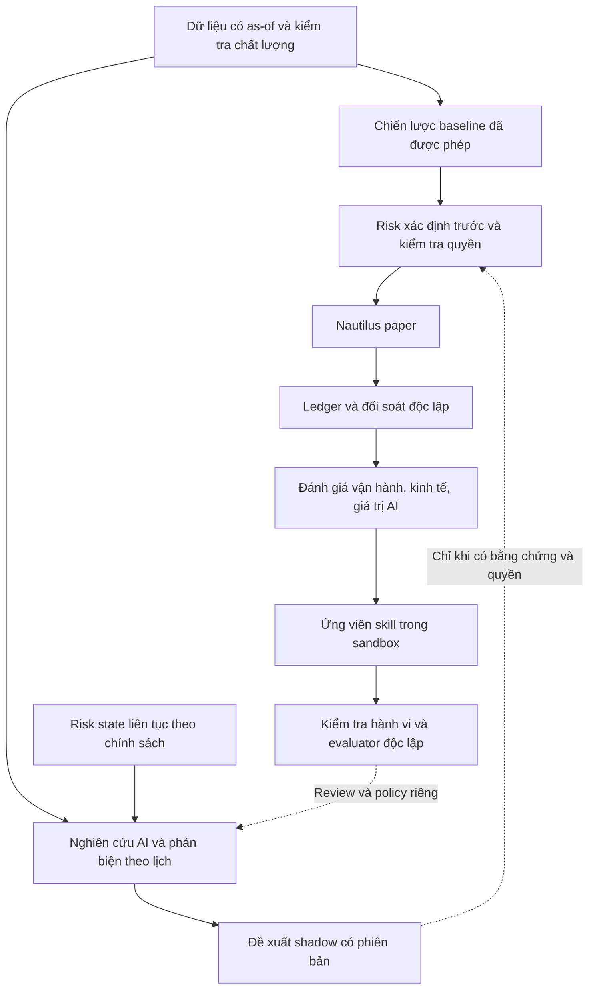

# North Star V4 — Đối chiếu open source và nghiên cứu

Ngày tra cứu: **2026-10-15**. Định hướng chuẩn: [North Star V4](../NORTH-STAR-V4.md).

**Bổ sung cùng ngày:** [vòng đánh giá từ issue, người dùng và thực nghiệm](2026-10-15-north-star-v4-real-world-review.md) làm rõ support của Nautilus v1, các lỗi đã sửa/chưa xác nhận, và chi phí AI. Giữ kết quả tra cứu dưới đây như snapshot ban đầu; khuyến nghị giữ engine cho candidate không có nghĩa giữ v1 vô thời hạn. Không suy ra đánh giá runtime từ một review hoặc metadata release.

## Kết luận cho chủ dự án

Giữ kiến trúc quant platform + Nautilus execution + AI research. Tập trung một hệ thống cá nhân **BTC spot, long/cash, paper, một venue**, có dữ liệu và sổ sách đáng tin. Giá trị phải được chứng minh theo ba mặt riêng: vận hành đúng, chiến lược đạt yêu cầu sau chi phí, AI tạo thêm lợi ích so với cùng hệ thống không dùng AI.

Đề xuất quan trọng nhất là xây **một vòng nghiên cứu–thực thi–đánh giá khép kín, nhỏ**, rồi mở rộng bằng kết quả thực nghiệm. Có thể tái sử dụng nhiều ý tưởng mà không đưa tất cả framework vào dependency graph. Không có nghiên cứu nào dưới đây cho phép gán xác suất thành công hoặc lợi nhuận tương lai cho Trading-Agent.

Đây là nghiên cứu nguồn có chọn lọc, không phải kiểm toán toàn bộ các repo hay tái lập thực nghiệm. “Mới nhất” là các release và công bố tìm thấy, kiểm tra tại thời điểm trên; không khẳng định bao quát mọi công trình. Release, nhánh phát triển, lời tác giả và hành vi đã chạy là những loại bằng chứng khác nhau.

## 1. Những dự án đáng dùng

Phiên bản trong bảng lấy từ GitHub Releases. Commit nguồn đã đọc được lưu ở [manifest](2026-10-15-north-star-v4-oss-manifest.json). Với Nautilus và Freqtrade, nhánh nguồn nghiên cứu là `develop`, không mặc định các tính năng đó có trong stable.

| Dự án / phiên bản tìm thấy | Phục vụ phần nào | Quyết định cho Trading-Agent |
| --- | --- | --- |
| [NautilusTrader stable 1.231.0](https://github.com/nautechsystems/nautilus_trader/releases/tag/v1.231.0), 02/08; [2.0.0rc6](https://github.com/nautechsystems/nautilus_trader/releases/tag/v2.0.0rc6), 05/10 | Engine, order events, simulation, reconciliation | Giữ nền 1.231 đang được repo xác định; RC chỉ là ứng viên nghiên cứu riêng nếu giải quyết khoảng trống cụ thể |
| [Freqtrade 2026.9](https://github.com/freqtrade/freqtrade/releases/tag/2026.9), 29/09 | Crypto strategies, backtesting, kiểm tra bias | Học kiểm tra lookahead/startup và dùng làm tham chiếu offline có kiểm soát; không thêm execution owner thứ hai |
| [Hummingbot 2.17.0](https://github.com/hummingbot/hummingbot/releases/tag/v2.17.0), 22/09 | Controllers và executors cho chiến lược crypto | Tham khảo khi có nhu cầu market making; chưa là dependency cần thiết cho BTC D1 |
| [Condor](https://github.com/hummingbot/condor/tree/45e60d6067bd311c154d7890c1ecc46f207b17e2), chưa có GitHub release | Agent chạy theo nhịp, memory, tools, journal và risk gate | Gần ý tưởng đội agent 24/7 nhất trong nhóm đã khảo sát; lấy cấu trúc điều phối và quan sát, không nhập nguyên quyền giao dịch |
| [TradingAgents 0.6.0](https://github.com/TauricResearch/TradingAgents/releases/tag/v0.6.0), 03/10 | Analyst, phản biện, tổng hợp và đánh giá quyết định | Dùng ý tưởng tổ chức nghiên cứu; giữ risk, portfolio và ledger của mình |
| [RD-Agent 1.0.0](https://github.com/microsoft/RD-Agent/releases/tag/v1.0.0), 23/09 | Tự đề xuất, viết và thử ứng viên nghiên cứu | Tham khảo vòng cải tiến trong sandbox ở giai đoạn sau |
| [Qlib 0.9.8](https://github.com/microsoft/qlib/releases/tag/v0.9.8), 08/10 | Quy trình quant, thí nghiệm và rolling evaluation | Tái sử dụng phương pháp quản lý thí nghiệm khi có nhu cầu; chưa di chuyển toàn bộ data stack |
| [CCXT 4.5.88](https://github.com/ccxt/ccxt/releases/tag/v4.5.88), 14/10 | Giao diện dữ liệu/exchange | Chỉ cân nhắc adapter cho khoảng trống cụ thể sau khi chọn venue; tránh hai đường quản lý lệnh |
| [FinRobot desktop-v0.1.0](https://github.com/AI4Finance-Foundation/FinRobot/releases/tag/desktop-v0.1.0), 07/07 | Nghiên cứu và báo cáo tài chính | Ưu tiên thấp hơn cho crypto; học cách tách tính toán khỏi diễn giải. Tag desktop và v1.0.0 thuộc các thế hệ khác nhau |
| [Awesome-TradingAI](https://github.com/Starlien95/Awesome-TradingAI/tree/1043d32e3eed6b6072de1c315c4cc549fc9506db), chưa có GitHub release | So sánh ML/RL/LLM qua backtest, paper và live | Học experiment manifest, capability matrix và cách phân biệt chế độ; không chọn chiến lược bằng thứ hạng khác giao thức |

### Những khác biệt chỉ thấy khi đọc sâu

- **Nautilus:** source `develop` có sandbox dùng matching engine với dữ liệu thị trường, nhưng đó không chứng minh adapter tương ứng đã có và được qualification trong 1.231 của ứng dụng. Repo hiện có policy 1.231 tại `engines/nautilus/v1.231-provenance-policy.json`. [Sandbox upstream](https://github.com/nautechsystems/nautilus_trader/blob/ce453eb995731e3873f0267dda5e4c3a7c514ac6/crates/adapters/sandbox/README.md).
- **Freqtrade:** lookahead analysis đối chiếu các lần chạy với đầu vào bị cắt; recursive analysis kiểm tra độ nhạy indicator với lịch sử khởi động. Chúng không chứng minh đã loại mọi bias. Backtest mặc định giả định khớp ở giá yêu cầu khi nằm trong high/low, không có slippage; phải chuẩn hóa mô hình chi phí trước khi so kết quả. [Lookahead](https://github.com/freqtrade/freqtrade/blob/183351d57b26b006659bc9ed390a046bd47809fc/docs/lookahead-analysis.md), [recursive](https://github.com/freqtrade/freqtrade/blob/183351d57b26b006659bc9ed390a046bd47809fc/docs/recursive-analysis.md), [backtesting](https://github.com/freqtrade/freqtrade/blob/183351d57b26b006659bc9ed390a046bd47809fc/docs/backtesting.md).
- **TradingAgents:** `backtest.py` đánh giá các ô ticker/date độc lập, không có quantities, fill prices và cash ledger của portfolio simulator. Đây là lý do nên ghép đầu ra nghiên cứu vào core hiện có thay vì thay core. [Mã nguồn](https://github.com/TauricResearch/TradingAgents/blob/1394a3f72aa4393e1a98f51b382434c4b4c2d972/tradingagents/backtest.py).
- **Condor:** có risk trước tick và kiểm tra tool mutation; nhưng `max_drawdown_pct`, `shutdown_drawdown_pct`, `max_drift_quote`, `max_leverage` mặc định `-1` (tắt). `dry_run` là tick suy luận không có quyền mutation, không phải bằng chứng một portfolio paper đã được mô phỏng đầy đủ. Nguồn dùng `float` cho các trường risk: không sao chép vào hợp đồng tiền cố định của Trading-Agent. [Risk source](https://github.com/hummingbot/condor/blob/45e60d6067bd311c154d7890c1ecc46f207b17e2/condor/agents/risk.py), [agent guide](https://github.com/hummingbot/condor/blob/45e60d6067bd311c154d7890c1ecc46f207b17e2/condor/agents/README.md).
- **Awesome-TradingAI:** capability matrix phân biệt interface công khai, adapter và hệ thống ngoài cần data/model/account riêng. Không phải mọi phương pháp trong bài báo đều là một gói tự đủ để tái lập ngay. [Capability matrix](https://github.com/Starlien95/Awesome-TradingAI/blob/1043d32e3eed6b6072de1c315c4cc549fc9506db/docs/METHOD_CAPABILITY_MATRIX.md).

## 2. Nghiên cứu mới thay đổi quyết định gì?

Các kết quả sau là **tác giả báo cáo**, chưa được tái lập ở Trading-Agent. Bài mới trên arXiv không mặc nhiên đã qua phản biện. Ngày công bố mới cũng không có nghĩa dữ liệu đánh giá mới.

| Công trình | Bằng chứng và giới hạn | Ý nghĩa cho V4 — suy luận thiết kế |
| --- | --- | --- |
| [SwingGuard](https://arxiv.org/html/2610.12988v1), 09/10/2026 | BTC/ETH, nghiên cứu hàng ngày và risk 5 phút; đánh giá 08/2024–01/2025, có phí và slippage; báo cáo kết quả tốt hơn một số ablation. Đây là backtest, không phải lời hứa lợi nhuận hiện tại | Tách nhịp nghiên cứu và giám sát risk; đưa trạng thái risk vào đầu vào nghiên cứu, vẫn kiểm tra độc lập trước thực thi. Không sao chép nguyên chu kỳ 5 phút hoặc giao risk cho LLM |
| [MintEval](https://arxiv.org/abs/2610.03080), 02/10/2026 | 800 bài sinh chiến lược từ mô tả, kiểm tra action theo từng bar trên BTCUSDT 15m; phát hiện code chạy được nhưng sai hành vi. Đo đúng ngữ nghĩa, không đo alpha | Skill sinh code cần oracle hành vi độc lập: signals, sizing, trạng thái và điều kiện thoát; LLM tự chấm và biểu đồ đẹp không đủ |
| [Can AI Make Money in Crypto?](https://arxiv.org/html/2609.34510v1), 28/09/2026 | So sánh 32 phương pháp; paper 04/06–21/09/2026, live 24/08–21/09. Trong bốn phương pháp ở bảng live, một có lãi, không phương pháp nào vượt BTC buy-and-hold. Cửa sổ ngắn; §3.3 nói năm phương pháp còn phần kết quả trình bày bốn | Đánh giá backtest, paper và live riêng; so trên cùng cửa sổ và chi phí. Không suy rộng kết quả này thành “mọi AI đều thua” |
| [Propose, Don't Judge](https://arxiv.org/abs/2609.27051), 22/09/2026 | Tách proposer khỏi referee đóng băng, chỉ dùng kết quả xuất hiện sau lúc nộp ứng viên; thử synthetic và CSI500. Tác giả ghi nhận đánh đổi: factor thật có thể chờ khoảng 500 ngày giao dịch mới được nhận | Học sự độc lập của evaluator; không nhập thêm một gate 500 ngày vào P3 hoặc tuyên bố bảo đảm thống kê khi chưa thỏa giả định |
| [EvolveTrade](https://arxiv.org/abs/2609.17632), 15/09/2026 | Cập nhật policy dạng prompt từ traces và feedback, giữ backbone; báo cáo cải thiện trong nhiều cấu hình. Trong đợt này chỉ đối chiếu abstract, chưa tái lập | “Tự sinh skill” nên khởi đầu bằng cải thiện cách tìm và kiểm tra thông tin, có phiên bản; chưa cho sửa code đang vận hành |
| [What LLM Trading Agents Actually Do in Production](https://arxiv.org/html/2609.05663v1), 04/09/2026 | Hai fleet có nguồn gốc chung, không thấy directional edge. Đặc biệt phần DXAP chủ yếu là paper, giả định zero slippage và zero funding; quan sát production không đồng nghĩa mọi fill là tiền thật | Dashboard phải hiển thị loại fill và giả định mô phỏng. Chú trọng quản lý vị thế, sự cố và chi phí hơn độ thuyết phục của lời giải thích |
| [Agentic Quantitative Trading survey](https://arxiv.org/abs/2608.31041), 31/08/2026 | Tổng hợp factor, signal, portfolio, execution, risk; là khảo sát, không phải thử nghiệm xác nhận một hệ thống có alpha | Hoàn chỉnh đường từ ý tưởng tới sổ sách, tránh chỉ đầu tư vào tầng tạo tín hiệu |
| [Bitcoin Trading Under Transaction Costs](https://arxiv.org/html/2606.00060v1), 2026 | Walk-forward dữ liệu giờ BTC; quy tắc giao dịch đơn giản suy giảm khi thêm phí, threshold theo chi phí giúp giảm churn. Không thiết lập ưu thế chắc chắn của model tốt nhất | Đưa chi phí vào quyết định giao dịch và đánh giá; “không giao dịch” là lựa chọn hợp lệ; kết quả H1 không tự chuyển sang D1 |
| [KTD-Fin](https://arxiv.org/abs/2605.28359), 27/05/2026 | CSI300, masking và phân tích attribution; kiểm tra lợi thế sau kiểm soát thông tin/memorization. Thị trường cổ phiếu, không trực tiếp chứng minh hiệu quả crypto | PIT ở công cụ truy xuất chưa loại được kiến thức lịch sử bên trong LLM; cần forward evaluation và lưu model/prompt/as-of |
| [RD-Agent-Quant](https://arxiv.org/html/2505.15155v2), bản sửa 25/09/2025 | Tự động nghiên cứu factor/model trên thị trường cổ phiếu; công trình nền cho repo đang phát triển. Hiệu quả được báo cáo không chuyển thành kỳ vọng BTC | Học vòng giả thuyết → code → thí nghiệm → feedback; đo riêng chất lượng và chi phí của từng ứng viên |

## 3. Kiến trúc nên làm rõ trong V4

Đây là đề xuất kiến trúc, chưa phải xác nhận các kết nối đã chạy. Ánh xạ vào owner hiện có: `services/job_scheduler` cho điều phối; research backend riêng cho AI; `packages/runtime_risk` cho risk; Nautilus và paper runtime cho thực thi; ledger/accounting cho kết quả; Control API cho đọc; Job API cho durable jobs; Operator API cho quyền đã định. Không tạo một orchestrator có quyền ghi xuyên mọi tầng.

**Đội tối thiểu:** một vai trò nghiên cứu/tổng hợp và một vai trò phản biện. Data validation, kế toán, phép tính, risk và lịch chạy chủ yếu là phần mềm xác định trước. Chỉ thêm chuyên viên khi đo được họ phát hiện thêm thông tin hoặc cải thiện quyết định đủ bù chi phí.

**Hai nhịp hoạt động:** nghiên cứu theo D1/sự kiện có ngân sách; risk và sức khỏe hệ thống theo nhịp phù hợp feed/mandate, không chờ LLM. Risk context vào nghiên cứu chỉ giúp giảm đề xuất không khả thi; kiểm tra cuối vẫn độc lập. Nhịp nhanh không tự cho phép đổi chiến lược D1 đã đóng băng.

**AI shadow trước:** ghi đề xuất mà chưa tác động lệnh. Khi đủ quyền và dữ liệu đánh giá, so ba cấu hình trên cùng mandate: baseline không AI; baseline cộng báo cáo AI; baseline cộng điều chỉnh giới hạn được duyệt. Cấu hình báo cáo chỉ nên được chấm về nghiên cứu/công sức, không gán lợi nhuận của engine cho AI.

## 4. Cách đánh giá khả năng thành công

Không có cơ sở để gán tỷ lệ 70% hay 90%. Có thể kiểm tra dần ba giả thuyết:

| Giả thuyết | Bằng chứng cần | Khi không đạt |
| --- | --- | --- |
| Hệ thống có ích cho chủ dự án | Một phiên xuyên suốt, dữ liệu truy nguyên, đối soát đúng, phục hồi và số phút thao tác quan sát được | Sửa luồng cốt lõi; chưa thêm agent hoặc model |
| Chiến lược có giá trị kinh tế | Kết quả ngoài mẫu/forward hợp lệ, costs, drawdown, exposure, turnover và uncertainty so với benchmark định trước | Giữ NONE_QUALIFIED/FAIL; nghiên cứu tiếp theo hợp đồng, không hạ ngưỡng |
| AI tạo thêm giá trị | Ablation cùng data/risk/costs, thời gian nghiên cứu thực tế, thông tin hữu ích hoặc cải thiện giao dịch có bằng chứng | Giữ AI ở báo cáo hoặc bỏ chức năng đó; không tăng tự chủ để bù thiếu hiệu quả |

Benchmark tối thiểu cho chiến dịch mới: giữ quote, BTC buy-and-hold và một baseline xác định trước; trình bày cả lợi nhuận tuyệt đối và rủi ro. Giữ quote không đồng nghĩa không có rủi ro, đặc biệt với stablecoin. Một chiến lược có thể có giá trị nhờ giảm drawdown dù không tối đa hóa return; tiêu chí này phải chốt trước, không đổi sau khi nhìn kết quả.

Tách PnL sau phí giao dịch khỏi kết quả sau phân bổ chi phí data/LLM/hạ tầng; không trừ chi phí hai lần. Lưu spread/slippage/fill assumptions và độ nhạy. Chênh lệch hai simulator là câu hỏi cần giải thích, không tự là lỗi của một bên hoặc chứng minh alpha.

Một protocol mới phải lưu source/data/model/prompt/skill versions, lịch sử số lần thử, thời điểm dữ liệu được biết, mẫu chưa dùng và cả lần thất bại. Kiểm thử code sinh ra dựa trên hành vi kỳ vọng viết độc lập; nếu không có oracle đáng tin thì ghi giới hạn, không dùng output của chính agent làm “ground truth”.

## 5. Thứ tự thực hiện đề xuất

1. **Giữ P3 hữu hạn:** đóng theo Definition of Done hiện có. Bài báo mới không tự thêm requirements, reset holdout hay đổi receipts. Một kết luận nghiên cứu không có chiến lược đủ chuẩn vẫn có giá trị, nhưng không mở economic gate.
2. **Chốt NS0:** một cặp BTC spot, venue/feed, quote, vốn paper, costs, budget, ngưỡng và incident policy. Chọn một đường paper. Chưa có mandate thì chưa tích hợp provider theo phỏng đoán.
3. **Hoàn thành NS1:** một fixture/replay đi hết research → plan → risk → paper nội bộ → ledger → dashboard. Dùng mock AI và kiểm tra đường bị chặn, no-trade, restart; không cần cài thêm các framework khảo sát để làm bước này.
4. **NS2–NS3 khi đủ điều kiện:** feed thực, paper theo strategy đủ chuẩn, giám sát liên tục; lưu AI shadow để chuẩn bị đánh giá riêng. Không suy ra qualification từ vài ngày demo.
5. **NS4:** thêm một thành phần AI hoặc factor/model mỗi lần, so với baseline. Ưu tiên thông tin và công cụ có gap đo được; dữ liệu tốt và kiểm soát turnover trước RL/multi-agent lớn.
6. **NS5:** vòng cải tiến kiểu RD-Agent; skill hẹp trước, kiểm tra ngữ nghĩa, evaluator độc lập và rollback. Không cho agent sửa risk, evaluator, dữ liệu đánh giá hoặc quyền của chính nó.

Không ưu tiên lúc này: futures/leverage, RL end-to-end, đa tài sản, nhiều engine cùng quản lý lệnh, tự huấn luyện foundation model, SaaS đa tenant và mở rộng giao diện không phục vụ quyết định vận hành. Đây là đề xuất thứ tự để tăng cơ hội hoàn thành và học được điều có ích, không phải khẳng định những hướng đó vô giá trị.

## 6. Hồ sơ bằng chứng và giới hạn kiểm tra

Local source đối chiếu: canonical HEAD `8ee1c18a5b99bca78738b6d5ca572bd0afb7c0b3`, checkout có thay đổi cục bộ. North Star V4, ADR và policy engine là nguồn cho định hướng và ranh giới; đợt này không audit lại toàn bộ P3 hoặc runtime.

| Artifact ledger | Phạm vi đã làm | Giới hạn |
| --- | --- | --- |
| REPO_MAP | GitHub metadata, default-branch HEAD, recursive trees, README và một số manifest của 10 repo | Không clone/build mọi repo; không phải inventory mọi dependency |
| ARCHITECTURE_MAP | Engine/core, workflow research, agent orchestration, experiment evaluation; ánh xạ với V4 | Sơ đồ mục tiêu, chưa xác nhận tương thích tích hợp |
| ENTRYPOINT_TRACE | Condor tick → provider/risk → prompt/tool gate → journal; TradingAgents grid → graph → memory/evaluation; RD-Agent quant loop → hypothesis → coding → running → feedback | Đọc tĩnh, không gọi model hoặc chạy giao dịch |
| BUILD_RUN_MATRIX | Lệnh upstream được phân biệt với lệnh đã chạy, bảng dưới | Không có kết quả external test/build để công bố PASS |
| RISK_REGISTER | Fill/cost assumptions, memory contamination, semantic failure, default risk disabled, evaluator leakage, engine/adapter compatibility | Không phải security audit toàn diện |
| REUSABLE_IDEAS | Workflow/journal của Condor, research của TradingAgents, bias checks của Freqtrade, vòng thử nghiệm của RD-Agent/Qlib, manifest của benchmark | Chưa copy/integrate source vào ứng dụng |

Các trace nguồn: [Condor engine](https://github.com/hummingbot/condor/blob/45e60d6067bd311c154d7890c1ecc46f207b17e2/condor/agents/engine.py), [TradingAgents graph](https://github.com/TauricResearch/TradingAgents/blob/1394a3f72aa4393e1a98f51b382434c4b4c2d972/tradingagents/graph/trading_graph.py), [RD-Agent quant loop](https://github.com/microsoft/RD-Agent/blob/484776c211e4fbbeef03e0ec00d6bbee7362a4f4/rdagent/app/qlib_rd_loop/quant.py).

| Kiểm tra/lệnh | Trạng thái và ý nghĩa |
| --- | --- |
| `git status --short`, `git rev-parse HEAD`, đọc nguồn/rules/V4/policy | Đã thực hiện; nhận diện checkout và bảo toàn thay đổi sẵn có |
| `gh api repos/{owner}/{repo}`, `commits/{branch}`, `releases`, `git/trees/{sha}?recursive=1`, `contents/{path}?ref={sha}` | Đã đọc GitHub metadata và source snapshot; manifest giữ SHA và hash file |
| Web search, arXiv abstract/HTML và GitHub release pages | Đã đọc; nguồn chính chủ, phân biệt abstract-only ở bảng nghiên cứu |
| Upstream `freqtrade lookahead-analysis`, `freqtrade recursive-analysis` | Chỉ đọc tài liệu; không chạy vì cần strategy/data/environment riêng |
| Upstream `quant-bench quickstart --offline --workspace ./qb-workspace` | Chỉ đọc README; chưa cài hay chạy harness nên không có kết quả tái lập |
| Build/test/lint của 10 upstream repo | Không chạy trong nghiên cứu chọn lọc; khả năng build và kết quả benchmark chưa được xác minh độc lập |
| Product tests/build của Trading-Agent | Không chạy vì thay đổi tài liệu; kiểm tra diff, links và ranh giới nội dung thay thế |

Một lần tải source Freqtrade theo đường dẫn cũ trả 404, đã tra tree và tải đúng `freqtrade/optimize/analysis/lookahead.py`; không phải lỗi của upstream. Shell không có alias `python`, thao tác xử lý văn bản dùng `python3`; không cài runtime mới. Bản tải tạm ở `/tmp/trading-v4-research-20261015-7d7zbb58`; manifest bền vững giữ liên kết commit để việc tra cứu không phụ thuộc thư mục tạm.

Không gọi paid model API, exchange/broker/account/order endpoint; không thay runtime, service, database, engine version hoặc trạng thái qualification. Nội dung này làm rõ roadmap; triển khai và chấp nhận ứng viên là công việc riêng theo quyền hiện hành.

Kiểm tra tài liệu trong lượt này: `git diff --check` exit 0; kiểm tra liên kết file tương đối, cặp code fence và parse JSON đạt. Diff riêng của V4 đã đối chiếu với bản chụp trước lượt sửa tại `/tmp/trading-v4-before-research.md`. Chỉ sửa V4 và tạo báo cáo/manifest trong `docs/research`; các thay đổi có trước được giữ nguyên. HEAD không đổi, chưa commit/push. Kết quả này chỉ xác nhận phạm vi tài liệu.
